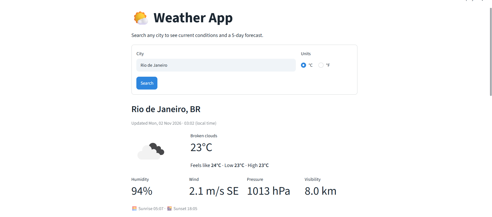
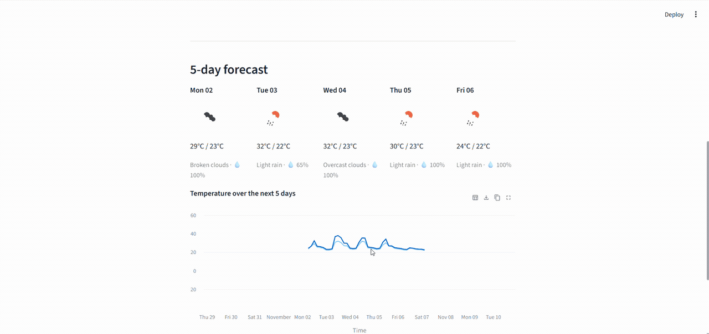

# 🌤️ Weather App

[](https://github.com/rafauto/Weather/actions/workflows/ci.yml)


[](LICENSE)

A web app that shows the **current weather** and a **5-day forecast** for any city in the world.
Built with Python and Streamlit, using data from the [OpenWeatherMap API](https://openweathermap.org/api).

[](https://weather-auegrhzznpfgb8gr4mmufc.streamlit.app/)

**Live demo:** [https://weather-auegrhzznpfgb8gr4mmufc.streamlit.app/](https://weather-auegrhzznpfgb8gr4mmufc.streamlit.app/)

## Features

- Search any city by name, with an optional country code (e.g. `Paris, FR`)
- Current conditions: temperature, feels-like, min/max, humidity, wind speed and direction, pressure, visibility, sunrise and sunset
- 5-day forecast with a daily summary (high/low, dominant condition, chance of rain)
- Interactive temperature chart for the next 5 days
- Switch between Celsius and Fahrenheit
- Responses cached for 10 minutes to stay within the free API quota
- Friendly error messages for unknown cities, invalid API keys, rate limits and network failures

## Screenshots

**Current weather**



**5-day forecast and temperature chart**



## Tech stack

| Area | Tools |
| --- | --- |
| Language | Python 3.10+ |
| Web framework | [Streamlit](https://streamlit.io/) |
| HTTP client | [Requests](https://requests.readthedocs.io/) |
| Data & charts | [pandas](https://pandas.pydata.org/), Streamlit charts |
| Weather data | [OpenWeatherMap](https://openweathermap.org/api) (Current Weather + 5 Day / 3 Hour Forecast) |
| Testing | [pytest](https://pytest.org/) |
| Linting & formatting | [Ruff](https://docs.astral.sh/ruff/) |
| CI | GitHub Actions |
| Hosting | Streamlit Community Cloud |

## Project structure

```
Weather/
├── app.py                     # Streamlit entry point (UI)
├── src/weather_app/
│   ├── api.py                 # OpenWeatherMap client and error types
│   ├── models.py              # Dataclasses and JSON parsers
│   ├── forecast.py            # Groups 3-hour forecast steps into daily summaries
│   └── formatting.py          # Units, wind direction, icon URLs
├── tests/                     # pytest suite (API calls are mocked)
│   └── fixtures/              # Sample API responses
├── docs/screenshots/          # Screenshot and GIF used in this README
├── .streamlit/
│   ├── config.toml            # Theme
│   └── secrets.toml.example   # Template for your API key
├── .github/workflows/ci.yml   # Lint + tests on every push
├── .devcontainer/             # GitHub Codespaces / VS Code Dev Container setup
├── requirements.txt
└── requirements-dev.txt
```

## Getting started

### Prerequisites

- Python 3.10 or newer
- A free OpenWeatherMap API key: [create an account](https://home.openweathermap.org/users/sign_up) and copy the key from the **API keys** tab.
  New keys can take up to 2 hours to activate.

### Installation

1. **Clone the repository**

   ```bash
   git clone https://github.com/rafauto/Weather.git
   cd Weather
   ```

2. **Create and activate a virtual environment**

   ```bash
   python -m venv .venv
   source .venv/bin/activate      # Windows: .venv\Scripts\activate
   ```

3. **Install the dependencies**

   ```bash
   pip install -r requirements.txt
   ```

4. **Add your API key**

   ```bash
   cp .streamlit/secrets.toml.example .streamlit/secrets.toml   # Windows: copy ...
   ```

   Then open `.streamlit/secrets.toml` and paste your key:

   ```toml
   OPENWEATHER_API_KEY = "your-api-key-here"
   ```

   `secrets.toml` is listed in `.gitignore`, so your key is never committed.
   Alternatively, you can set an `OPENWEATHER_API_KEY` environment variable.

5. **Run the app**

   ```bash
   streamlit run app.py
   ```

   The app opens at <http://localhost:8501>.

## Usage

Type a city in the search box, choose °C or °F and press **Search**.
If a city name is ambiguous, add the country code: `Springfield, US`, `Valencia, ES`.

The weather client can also be used on its own from Python:

```python
from weather_app.api import WeatherClient
from weather_app.forecast import summarize_by_day

client = WeatherClient("your-api-key-here")

now = client.get_current_weather("Rio de Janeiro", units="metric")
print(f"{now.city}: {now.description}, {now.temperature:.0f}°C")
# Rio de Janeiro: Scattered clouds, 25°C

for day in summarize_by_day(client.get_forecast("Rio de Janeiro").entries):
    print(f"{day.day:%a %d}  {day.temp_min:.0f}–{day.temp_max:.0f}°C  {day.description}")
```

(Run it from the project root with `PYTHONPATH=src`.)

## Running the tests

```bash
pip install -r requirements-dev.txt
pytest            # run the test suite
ruff check .      # lint
ruff format .     # format
```

The tests use saved sample responses, so they run offline and don't need an API key.

## Deployment

The app is live at **[weather-auegrhzznpfgb8gr4mmufc.streamlit.app](https://weather-auegrhzznpfgb8gr4mmufc.streamlit.app/)**, hosted for free on [Streamlit Community Cloud](https://streamlit.io/cloud).

To deploy your own copy:

1. Sign in at [share.streamlit.io](https://share.streamlit.io) with GitHub.
2. Click **Create app** → select this repository, branch `main` and main file `app.py`.
3. Under **Advanced settings → Secrets**, add `OPENWEATHER_API_KEY = "your-key"`.
4. Click **Deploy**.

## Project status

**Version 1.0 complete.** Possible next steps:

- [ ] Detect the user's location automatically
- [ ] Hourly forecast view
- [ ] Save favourite cities
- [ ] Air quality index

## Contributing

Contributions are welcome! Please read [CONTRIBUTING.md](CONTRIBUTING.md) before opening an issue or pull request.

## License

This project is licensed under the [MIT License](LICENSE).

## Author

**Rafaela Uto**: [GitHub @rafauto](https://github.com/rafauto)
